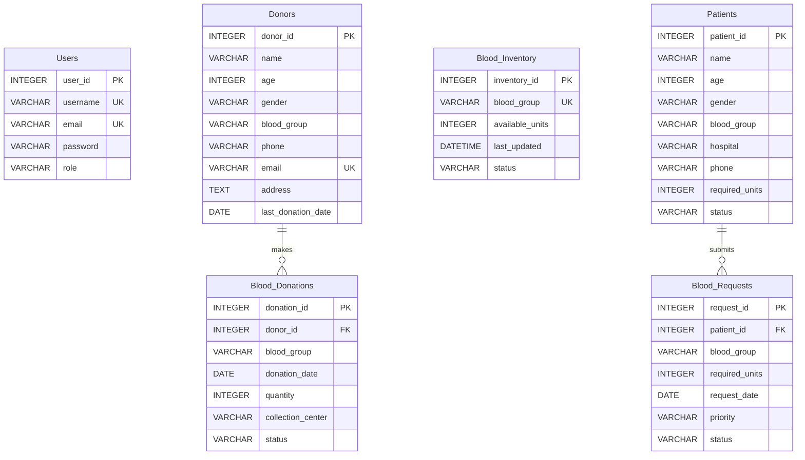

# LifeFlow - Blood Bank Management System

> **A Modern, Full-Stack Healthcare Web Application for College Project Presentation**  
> Specifically designed to demonstrate **Frontend / UI Development** and **Relational Database Design**.

---

## 🌟 Project Overview

**LifeFlow** is a comprehensive, responsive, and functional Blood Bank Management System created for academic evaluation and clinical workflow demonstration. It bridges real-time blood stock tracking, donor management, hospitalized patient requisition handling, and clinical reporting with a relational database engine.

### Core Academic Demonstrations:
1. **Frontend / UI Development**:
   - Healthcare design system (Medical Crimson `#dc2626` / `#b91c1c`, Pure White `#ffffff`, and Light Slate Gray `#f8fafc`).
   - Responsive sidebar with mobile hamburger menu and collapsible navigation.
   - Interactive KPI cards, visual progress meters, and Chart.js dynamic visualizations.
   - Real-time search, multi-column filtering, modal dialogs with form validation, and toast feedback.
2. **Relational Database Design**:
   - 6 normalized tables (3NF): `Users`, `Donors`, `Patients`, `Blood_Donations`, `Blood_Inventory`, `Blood_Requests`.
   - Strict Primary Key (`PK`) and Foreign Key (`FK`) referential integrity with cascading deletes.
   - Automatic inventory synchronization: completed donations increment stock; fulfilled requests decrement stock with shortage validation.
   - Dedicated **Database Schema & ERD Demonstration Page** featuring live database introspection, visual ERD cards, live raw table inspector, and instant `schema.sql` download.

---

## 🏗️ Technology Stack

| Layer | Technology | Rationale |
|---|---|---|
| **Frontend UI** | HTML5, CSS3, Modern ES6+ JavaScript | Zero build step, fast loading, responsive across desktop & mobile |
| **Data Visualization** | Chart.js (v4.4.1 bundled locally) | Works 100% offline during classroom/viva presentations |
| **Backend Architecture** | Node.js Modular MVC / Controller-Route Architecture | Modular REST API with dedicated controllers (`donor`, `inventory`, `donation`, `patient`, `request`, `report`, `schema`) |
| **Database Integration** | **MySQL 8.0 Engine (`mysql2` Connection Pool)** | Real live connection pool to MySQL 8.0 (`localhost:3306`, DB: `blood_bank_db`) with seamless SQLite 3 fallback |
| **Database Scripts** | Native MySQL (`blood_bank_mysql.sql`) & ANSI SQL (`schema.sql`) | Production-ready schemas with Foreign Keys, Cascades, and Indexes |

---

## 🗄️ Relational Database Architecture

### Entity-Relationship Diagram (ERD)



### Table Details & Constraints

1. **`Users`**: System authentication and role-based access (`Admin`, `Staff`, `Technician`).
2. **`Donors`**: Stores donor demographics, contact information, blood type, and last donation date (used to calculate 90-day donation eligibility).
3. **`Patients`**: Hospitalized individuals requiring transfusions, current clinical status (`Admitted`, `Critical`, `Stable`, `Discharged`), and assigned medical centers.
4. **`Blood_Donations`**: Donation logs linked to `Donors(donor_id)` via Foreign Key (`ON DELETE CASCADE`). Recording a completed donation automatically updates `Blood_Inventory`.
5. **`Blood_Inventory`**: Real-time units (450mL bags) for all 8 blood groups (`A+`, `A-`, `B+`, `B-`, `AB+`, `AB-`, `O+`, `O-`). Status is computed dynamically (`Available` $\ge$ 10, `Low Stock` 1-9, `Out of Stock` 0).
6. **`Blood_Requests`**: Hospital orders linked to `Patients(patient_id)` via Foreign Key (`ON DELETE CASCADE`). Fulfilling an order automatically verifies stock availability and decrements `Blood_Inventory`.

---

## 🚀 Getting Started

### Prerequisites
- **Node.js** (v22.5.0 or later, v24 recommended)
- **Web Browser** (Chrome, Edge, Firefox, Safari)

### Quick Start (Zero npm install needed!)
1. Open PowerShell / Command Prompt in the project folder:
   ```bash
   cd "C:\Users\Aditya Dube\.gemini\antigravity\scratch\blood-bank-system"
   ```
2. Start the application:
   ```bash
   node server.js
   ```
   *(or `npm start`)*

3. Open your browser and navigate to:
   ```
   http://localhost:3000
   ```

### Demo Login Credentials
- **Email / Username**: `admin@bloodbank.org` (or `admin`)
- **Password**: `admin123`
- *(Use the **"Autofill"** button on the login screen for instant one-click login during viva presentation!)*

---

## 📱 Application Modules & Pages

1. **Login Page**:
   - Healthcare-themed login portal with branding and emergency helpline indicator.
   - Demo credentials autofill button and password toggle.
2. **Dashboard**:
   - 4 Top KPI Cards (Total Donors, Total Patients, Available Units, Pending Requests).
   - 8-Group Blood Availability Overview with visual progress bars and status indicators.
   - Chart.js Visualizations (Stock Distribution and 6-Month Donation vs Demand trend).
   - Recent Blood Donations and Recent Hospital Requests tables.
3. **Donor Management**:
   - Complete CRUD (Add, Edit, View, Delete).
   - Live Search (by name, phone, email, donor ID) and Blood Group dropdown filter.
   - 90-Day Eligibility Calculator based on last donation timestamp.
   - Detailed Donor Profile modal showing historical donations.
4. **Blood Inventory**:
   - Dedicated cards for all 8 blood groups (`A+`, `A-`, `B+`, `B-`, `AB+`, `AB-`, `O+`, `O-`).
   - Units on shelf, capacity percentage meter, last calibrated timestamp, and stock status.
   - Manual Stock Adjustment modal with audit logging.
5. **Blood Donation Management**:
   - Record blood donations with donor selection (foreign key linkage auto-fills donor's blood type).
   - Volume tracking (450ml bags) and collection center tagging.
   - Automatic inventory synchronization on completed donation.
6. **Patient Management**:
   - Comprehensive patient registry with hospital assignment and contact details.
   - Live search and filtering by blood group and clinical urgency status (`Critical`, `Admitted`, `Stable`).
   - Profile modal showing all blood requests associated with the patient.
7. **Blood Request Management**:
   - Hospital requisitions with Priority badges (`Urgent`, `High`, `Normal`) and Status workflow (`Pending` $\rightarrow$ `Approved` $\rightarrow$ `Fulfilled` / `Rejected`).
   - **One-Click Fulfill Action**: Verifies stock in `Blood_Inventory`, throws an alert if stock is insufficient, or decrements inventory units and marks the order as fulfilled.
8. **Reports & Analytics**:
   - Analytical summaries, doughnut chart of blood stock share, horizontal bar chart of hospital demand.
   - Print-optimized view (`Ctrl+P` or "Print Official Report" button).
9. **Database Design & ERD Demonstration**:
   - Live Entity-Relationship Diagram (ERD) cards showing all 6 tables, primary keys (`PK 🔑`), foreign keys (`FK 🔗`), and types.
   - Live Table Inspector tab allowing evaluation of raw SQLite rows.
   - Formatted ANSI SQL viewer with "Copy SQL" button.
   - Direct download link for `schema.sql`.
   - "Reset Seed Data" button to restore pristine sample records at any point during presentation.

---

## 📂 Project Directory Structure

```
blood-bank-system/
├── server.js              # Native Node.js HTTP server & RESTful routing engine
├── db.js                  # Database manager, SQLite connection, schema loader, CRUD queries
├── schema.sql             # ANSI SQL schema DDL, foreign keys, indexes, and realistic seed data
├── blood_bank.db          # Auto-generated persistent SQLite database
├── package.json           # Project metadata and start scripts
├── README.md              # Project documentation and presentation guide
└── public/
    ├── index.html         # Single Page Application HTML shell
    ├── css/
    │   └── styles.css     # Healthcare red/white/light-gray theme stylesheet
    └── js/
        ├── api.js         # REST client communicating with /api endpoints
        ├── app.js         # SPA state manager, router, modal & toast controller
        ├── charts.js      # Dynamic Chart.js visualizations
        ├── lib/
        │   └── chart.umd.js # Offline bundled Chart.js library
        └── pages/
            ├── login.js       # Login page controller
            ├── dashboard.js   # Dashboard metrics & charts
            ├── donors.js      # Donor CRUD & eligibility
            ├── inventory.js   # 8 Blood groups cold storage
            ├── donations.js   # Donation logging & inventory sync
            ├── patients.js    # Patient registry & hospital tracking
            ├── requests.js    # Request workflow & fulfillment engine
            ├── reports.js     # Analytics & print report
            └── schema.js      # Visual ERD, raw table inspector & SQL download
```

---

## 🎓 College Viva / Project Evaluation Highlights

When presenting this project to your professor or evaluator:
1. **Explain the Normalization (3NF)**: Show how Donors, Donations, Patients, and Requests are isolated to avoid data redundancy and update anomalies.
2. **Demonstrate Referential Integrity**: Highlight how a donation cannot exist without a valid Donor ID (`FOREIGN KEY (donor_id) REFERENCES Donors(donor_id) ON DELETE CASCADE`).
3. **Show Automated Inventory Sync**:
   - Record a donation of 2 units of `O+` $\rightarrow$ Show `Blood_Inventory` increasing.
   - Fulfill a blood request for 2 units of `O+` $\rightarrow$ Show `Blood_Inventory` decreasing.
4. **Navigate to the "Database & ERD" Tab**: Show the visual ERD, inspect raw rows directly from SQLite, and demonstrate the download of `schema.sql`.
